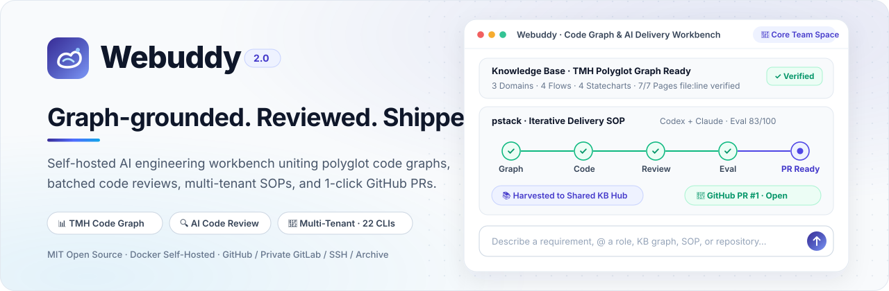
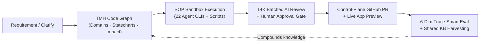
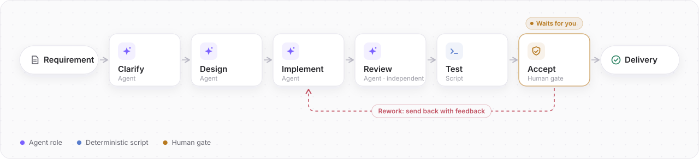

<p align="center">
  <picture>
    <source media="(prefers-color-scheme: dark)" srcset="docs/assets/readme/hero-en-dark.svg">
    
  </picture>
</p>

<p align="center">
  
  
  
  
  <a href="LICENSE"></a>
</p>

<p align="center">
  <a href="README.md">简体中文</a> · <b>English</b>
</p>

<p align="center">
  <a href="#core-capabilities">Core Capabilities</a> ·
  <a href="#delivery-loop">Delivery Loop</a> ·
  <a href="#quick-start">Quick Start</a> ·
  <a href="#repositories--runners">Repos &amp; Runners</a> ·
  <a href="#sops--smart-eval">SOPs &amp; Smart Eval</a> ·
  <a href="#documentation">Docs</a>
</p>

---

**Webuddy 2.0** is an enterprise-ready, **self-hosted AI software engineering workbench** anchored on a zero-dependency **TMH Polyglot Code Graph**, uniting **Main Bot chat workspaces, visual SOP delivery pipelines, 14K batched full-repo AI code reviews, 6-dimension Trace Smart Evaluation, and strict multi-tenant governance**.

Connect **GitHub, self-hosted HTTP(S) GitLab/Gitea (including private LAN/IPv4 endpoints), Git SSH repositories**, or upload **`.zip` / `.tar.gz` code archives** directly without Git. Webuddy automatically maps business domains, execution flows, database schemas, and deterministic statecharts, orchestrates **22 coding-agent CLIs** (Codex, Claude Code, CodeBuddy, OpenCode, Cursor CLI, Gemini CLI, Antigravity, Kimi Code, Devin CLI, and more), opens real Pull Requests from the control plane even when execution runners are air-gapped, and harvests run lessons into a Tenant Shared Knowledge Hub.

---

## Core Capabilities

| Capability | Engineering Problem Solved | What Webuddy 2.0 Ships |
| :--- | :--- | :--- |
| **📊 TMH Polyglot Code Graph (`webuddy_core`)** | Coding agents hallucinate boundaries and break state transitions in legacy repos | Bundled Python-stdlib engine supporting Go, Python, TS/JS, Node HTTP, NestJS, Next.js, Rust, Java, C#, PHP, and SQL; extracts **Domains, Flows, Tables, and deterministic Statecharts**, bootstraps 4 core engineering KB pages (`glossary`, `decisions`, `pitfalls`, `open-questions`) with `file:line` evidence verification, and shallow-mirrors remote GitHub/GitLab repos automatically. |
| **🔍 14K Batched AI Code Review** | Large diffs overflow context windows or ship unverified blockers | Splits large diffs into structured review batches with blocker/advisory severity, human validity scoring, and approval-gate enforcement. |
| **🧭 Visual SOP Pipelines & `pstack` Suite** | Ad-hoc chat sessions aren't repeatable across engineering teams | Visual canvas combining **Agent, Script, Human Gate, Sub-SOP, and Preview** nodes; ships 4 generic delivery SOPs + 4 `pstack` discipline SOPs, with 1-click cloning into tenant-shared templates. |
| **🏅 6-Dim Smart Eval & Shared KB Harvesting** | Hard to diagnose slow/flaky SOPs; lessons get lost in run logs | Evaluates finished runs across 6 trace dimensions with **1-click applyable SOP governance patches**, and automatically harvests `knowledge.md` / `lessons-encoded.md` into the **Tenant Shared KB Hub**. |
| **🚀 Universal Repo Onboarding & Control-Plane PRs** | Private LAN GitLab URLs and air-gapped runners block PR automation | Supports **GitHub, self-hosted HTTP(S) GitLab (including IPv4:port), Git SSH, and `.zip/.tar.gz` uploads**; materializes `repository-patch` artifacts on the control plane to push branches and open real GitHub Pull Requests automatically or in 1 click (credentials scoped in memory env headers, never written to argv or `.git/config`). |
| **🏢 Multi-Tenant Isolation & Fine-Grained RBAC** | Multiple teams sharing one deployment leak projects, KBs, or metrics | Zero-reload SPA tenant switching, invite codes, member RBAC roles, and strict tenant isolation across projects, KB repos, shared KB, sessions, metrics, and environment views. |
| **🖥️ Live App Preview & Embedded VS Code Web** | Reviewers need live UI verification and direct workspace inspection | Launches project servers behind `/app-preview/<projectId>/` HTTPS proxying and embeds **VS Code Web** inside run details for instant file inspection and takeover. |

---

## Delivery Loop



<p align="center">
  <picture>
    <source media="(prefers-color-scheme: dark)" srcset="docs/assets/readme/sop-flow-en-dark.svg">
     Clarify, Design, Implement, Review -> Script Test -> Human Gate -> PR Delivery" width="100%">
  </picture>
</p>

---

## Quick Start

Clone the repository on any Linux or macOS host with **Git** (the installer checks Docker, Compose, Python 3, and curl, and offers to install missing dependencies; set `WEBUDDY_YES=1` for non-interactive setup):

```bash
git clone https://github.com/auntunt/webuddy-next-loopforge.git
cd webuddy-next-loopforge
./start.sh
```

`./start.sh` pulls the pre-built multi-arch image (`linux/amd64` + `linux/arm64`), generates `.env` secrets, starts MySQL (`webuddy`) and `platform` (`0.0.0.0:8090`), applies schema extensions, and prints reachable URLs.

```bash
./start.sh status     # inspect container & health status
./start.sh logs       # follow platform logs
./start.sh pull       # pull latest release image & apply migrations
./start.sh dev        # build and run from local source
./start.sh stop       # stop containers while preserving data volumes
```

---

## Repositories & Runners

- **4 Repository Onboarding Modes**: GitHub PAT/OAuth (`https://github.com/owner/repo`), self-hosted HTTP(S) GitLab/Gitea (`http://127.0.0.1:8929/group/repo.git` or LAN domain), Git SSH (`git@host:group/repo.git`), and direct `.zip` / `.tar.gz` archive uploads.
- **Docker Sandboxes & 1-Line Connected Runners**: Run steps in isolated Docker containers or connect Linux, macOS, or Windows WSL2 Runner machines to reuse local CLI logins (**Codex, Claude Code, CodeBuddy, OpenCode, Cursor CLI, Gemini CLI**, etc.) and private network access.

---

## SOPs & Smart Eval

- **Zero-Key Demo SOP**: The first registered account becomes platform admin and can immediately run the built-in script + human approval demo SOP without any LLM API key.
- **`pstack` Engineering SOPs & Trace Evaluation**: Clone preset SOPs into your tenant workspace, run deliveries end-to-end, score trace quality on `#/runs/:id` (**Smart Eval**), and apply recommended prompt/gate patches in one click.

---

## Documentation

| Topic | Entry Point |
| :--- | :--- |
| Production deployment, HTTPS reverse proxy, env vars, backups & releases | [Deployment Guide](docs/deployment.md) |
| Conversation workspaces, AI scheduled tasks & token pricing | [Conversation Workspaces](docs/conversation-workspaces.md) · [AI Scheduled Tasks](docs/ai-scheduled-task-capabilities.md) · [Token Pricing](docs/token-pricing.md) |
| Platform architecture & HTTP / MCP APIs | [Architecture](docs/architecture.md) · [API Reference](docs/api/README.md) · [Shared Schedules API](docs/api/shared-schedules.md) |
| Frontend UI & design conventions | [Design Conventions](design.md) |
| Chinese homepage | [简体中文主页](README.md) |

---

## License

[MIT License](LICENSE) (evolved from LoopForge with Webuddy 2.0's polyglot code graph, batched code review, multi-tenant governance, and end-to-end PR delivery suite). Third-party components retain their original licenses; see [THIRD_PARTY_NOTICES.md](THIRD_PARTY_NOTICES.md).
