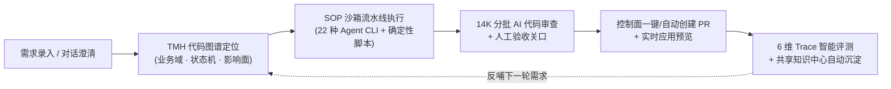

<p align="center">
  <picture>
    <source media="(prefers-color-scheme: dark)" srcset="docs/assets/readme/hero-zh-dark.svg">
    
  </picture>
</p>

<p align="center">
  
  
  
  
  <a href="LICENSE"></a>
</p>

<p align="center">
  <b>简体中文</b> · <a href="README.en.md">English</a>
</p>

<p align="center">
  <a href="#核心能力全景">核心能力</a> ·
  <a href="#端到端交付闭环">交付闭环</a> ·
  <a href="#三分钟快速部署">快速部署</a> ·
  <a href="#全场景代码源与执行机接入">代码源与 Runner</a> ·
  <a href="#sop-编排与智能评测">SOP 与智能评测</a> ·
  <a href="#文档导航">文档</a>
</p>

---

**Webuddy 2.0** 是一套面向研发团队的**可自托管智能软件工程工作台**——以 **TMH 多语言代码图谱**为底座，串联 **Main Bot 对话协作、可视化 SOP 交付流水线、14K 分批全量 AI 代码审查、6 维 Trace 智能评测与多租户空间治理**。

无论是直接接入 **GitHub / 私有 GitLab HTTP(S) / Git SSH 仓库**，还是零 Git 环境直接上传 **`.zip` / `.tar.gz` 代码压缩包**，Webuddy 都能自动构建业务域、流程链路与状态机图谱，统一调度 **22 种主流编程 Agent CLI**（Codex、Claude Code、CodeBuddy、OpenCode、Cursor CLI、Gemini CLI、Antigravity、Kimi Code、Devin CLI 等），并在人工验收或完结后自动向远端仓库推送分支、创建真实 Pull Request / Merge Request，同时将每次运行的工程经验自动沉淀回团队共享知识中心。

---

## 核心能力全景

| 核心模块 | 解决什么痛点 | Webuddy 2.0 工程实现 |
| :--- | :--- | :--- |
| **📊 TMH 多语言代码图谱 (`webuddy_core`)** | Agent 不懂存量业务边界、幻觉改坏状态流转 | 零外部第三方依赖内置引擎；覆盖 Go / Python / TS / JS / Node HTTP / NestJS / Next.js / Rust / Java / C# / PHP / SQL；自动抽取**业务域 · 核心流程 · 数据表 · 确定性业务状态机 (Statecharts)**，自动生成术语表、架构决策、踩坑指南与待决问题，支持 `file:line` 源码行级溯源核验；远端 GitHub/GitLab 仓库自动浅克隆镜像并实时扫描。 |
| **🔍 14K 分批全量 AI 代码审查** | 大改动 Diff 超出上下文窗口、问题漏审或误报多 | 按批拆分大型 Diff 进行深度审查，分级输出阻断项（Blocker）与建议项；支持人工有效性打分闭环，阻断项未解除自动拦截验收关口。 |
| **🧭 可视化 SOP 流水线 & `pstack` 纪律** | 纯对话交付不可复现、多人团队缺乏统一工程标准 | 可视化画布编排 **Agent · 脚本 · 人工关口 · 子 SOP · 预览构建** 节点；内置 4 条通用交付 SOP 与 4 条 `pstack` 工程纪律 SOP（现状核对、小步迭代、实证审查、减法重构），支持一键克隆定制为租户共享模板。 |
| **🏅 6 维 Trace 智能评测 & 经验自动沉淀** | 跑完不知道 SOP 哪里低效、踩坑经验随运行流失 | 完结运行支持一键触发大模型全链路 Trace 评测（控制流健康、耗时、工具效率、Token、错误恢复、交付完整 6 维打分），生成**一键可回写 SOP 治理补丁**；产出 `knowledge.md` / `lessons-encoded.md` 自动去重入库至**租户共享知识中心**。 |
| **🚀 全场景代码接入 & 控制面 PR 交付** | 内网私有 GitLab 难接入、隔离沙箱无外网无法提 PR | 原生支持 **GitHub、自建私有 GitLab HTTP(S)（含内网 IPv4 端口）、Git SSH、本地目录及 `.zip/.tar.gz` 压缩包上传**；即使 WSL2 / 内网 Runner 处于无外网隔离环境，控制面也可基于 `repository-patch` 自动或一键推送分支并创建真实 GitHub PR（凭据全程走内存环境变量作用域头，零命令行或配置落盘泄露）。 |
| **🏢 企业多租户隔离 & 细粒度 RBAC** | 多团队共用一套平台导致项目、知识库与指标串租 | 独立团队空间无刷秒切、邀请码准入、成员角色权限管控；项目、代码知识库、共享知识中心、会话记录、SOP 指标与环境概览均严格按租户隔离，非管理员自动脱敏并收敛特权入口。 |
| **🖥️ 实时应用预览 & 内置 Web IDE** | 后端/前端改动无法在浏览器当场验收 | 支持一键拉起项目服务并通过 `/app-preview/<projectId>/` HTTPS 安全代理内嵌交互预览；运行详情内置 **VS Code Web 工作区**，随时检视与接管沙箱文件。 |

---

## 端到端交付闭环



<p align="center">
  <picture>
    <source media="(prefers-color-scheme: dark)" srcset="docs/assets/readme/sop-flow-zh-dark.svg">
    
  </picture>
</p>

---

## 三分钟快速部署

准备一台装有 **Git** 的 Linux 或 macOS 机器（安装脚本会自动检测并按需引导补装 Docker、Docker Compose、Python 3 与 curl；支持 `WEBUDDY_YES=1` 全自动非交互安装）：

```bash
git clone https://github.com/auntunt/webuddy-next-loopforge.git
cd webuddy-next-loopforge
./start.sh
```

`./start.sh` 默认直接拉取预构建多架构发布镜像（`linux/amd64` + `linux/arm64`），无需在本机耗时编译：

1. 自动生成 `.env`（唯一随机数据库密码、会话密钥及 `${WEBUDDY_DATA_DIR}` 持久化目录）；
2. 启动 `mysql`（库名 `webuddy`）与 `platform`（默认监听 `0.0.0.0:8090`）；
3. 健康检查通过后自动执行增量 Schema 迁移（含 `webuddy_code_reviews`、观测指标列与多租户存储初始化）；
4. 自动输出公网、局域网与本机可访问的工作台地址。

### 国内镜像测速与源码构建模式

针对国内网络环境，`./start.sh` 与 `./start.sh pull` 会并行探测官方 `ghcr.io` 与南京大学镜像源 `ghcr.nju.edu.cn`，严格校验 SHA-256 Manifest 摘要一致后高速拉取：

```bash
./start.sh                                                                 # 自动测速选择最快镜像源启动
MIRROR=ghcr.nju.edu.cn ./start.sh pull                                     # 强制经南京大学镜像拉取升级
GOPROXY=https://goproxy.cn,direct NPM_REGISTRY=https://registry.npmmirror.com ./start.sh dev
                                                                           # 使用国内 Go/npm 源从本地源码构建启动
```

常用生命周期命令：

```bash
./start.sh status     # 查看服务容器与健康状态
./start.sh logs       # 实时查看平台日志
./start.sh pull       # 拉取最新镜像并执行无损增量迁移
./start.sh restart    # 平滑重启平台容器
./start.sh stop       # 停止服务（完整保留数据库与持久化卷）
./start.sh dev        # 切换至本地源码构建模式
./start.sh release    # 切回预编译发布镜像模式
```

---

## 全场景代码源与执行机接入

### 1. 四种代码接入方式（新建项目向导第 2 步直达）
- **GitHub 仓库**：在「设置 → Git 配置」粘贴 GitHub Personal Access Token（或启用 OAuth），粘贴 `https://github.com/owner/repo` 即可绑定、自动镜像扫描知识库，并支持控制面自动/一键创建 GitHub PR。
- **自建私有 GitLab / Gitea HTTP(S)**：原生支持企业内网域名或 IPv4 端口地址（如 `http://127.0.0.1:8929/group/repo.git`、`https://gitlab.corp.local/team/app.git`）配合主机级 HTTP 访问令牌。
- **Git SSH 仓库**：支持 `git@host:group/repo.git` 与自定义端口 `ssh://git@host:port/group/repo.git`，平台内置 SSH 主机指纹信任管理。
- **零 Git 代码压缩包直传**：在建项向导或项目设置直接拖拽上传 `.zip` / `.tar.gz` / `.tgz` 源码包，自动持久化解压至 `${WEBUDDY_DATA_DIR}/uploaded-repos` 并触发全量 TMH 图谱构建。

### 2. 22 种编程 Agent CLI 与独立执行机（Runner）
平台支持两类执行算力：
- **内置 Docker 沙箱**：开箱即用，每次对话工作区或 SOP 运行分配独立隔离容器；
- **一行命令接入外部 Runner 执行机**（Linux / macOS / Windows WSL2）：在「平台管理 → 执行机」生成绑定命令，即可将团队服务器或开发机接入控制面，直接复用本机已登录的 **Codex、Claude Code、CodeBuddy、OpenCode、Cursor CLI、Gemini CLI** 等 22 种 CLI 算力与内网测试环境。

---

## SOP 编排与智能评测

1. **开箱即用模板**：
   - **免 Key 快速体验**：注册首个账号（自动成为平台管理员）后即可运行体验项目中的「平台验收 · 脚本与审批」SOP；
   - **`pstack` 工程纪律套件**：内置 `pstack · 现状核对`、`pstack · 小步迭代与实证交付`、`pstack · 实证代码审查`、`pstack · 减法重构`，团队管理员可一键克隆至当前租户空间共享。
2. **智能评测闭环**：
   - 任意已完结 SOP 运行打开「智能评测」标签页即可启动 6 维量化诊断，针对薄弱节点直接点击 **「应用此修改」** 将门禁或提示词补丁回写至流程定义。

---

## 文档导航

| 主题 | 文档入口 |
| :--- | :--- |
| 生产部署、HTTPS 反向代理、环境变量、备份与发版 | [部署与运维指南](docs/deployment.md) |
| 对话工作区机制、AI 定时任务与 Token 成本核算 | [对话工作区](docs/conversation-workspaces.md) · [AI 定时任务](docs/ai-scheduled-task-capabilities.md) · [Token 成本统计](docs/token-pricing.md) |
| 平台架构与 HTTP / MCP 开放接口 | [系统架构](docs/architecture.md) · [API 参考手册](docs/api/README.md) · [共享定时任务 API](docs/api/shared-schedules.md) |
| 前端视觉与交互规范 | [前端设计约定](design.md) |
| 英文版主页 | [English README](README.en.md) |

---

## 开源许可

本项目采用 [MIT License](LICENSE) 开源（基于 LoopForge 架构深度演进构建 Webuddy 2.0 代码图谱、全量审查、多租户治理与全链路交付体系）。第三方依赖组件保留各自原始许可证与声明，详见 [THIRD_PARTY_NOTICES.md](THIRD_PARTY_NOTICES.md)。
