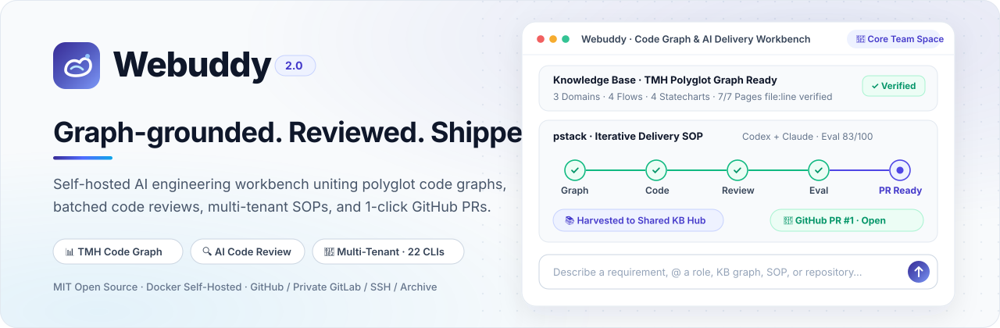
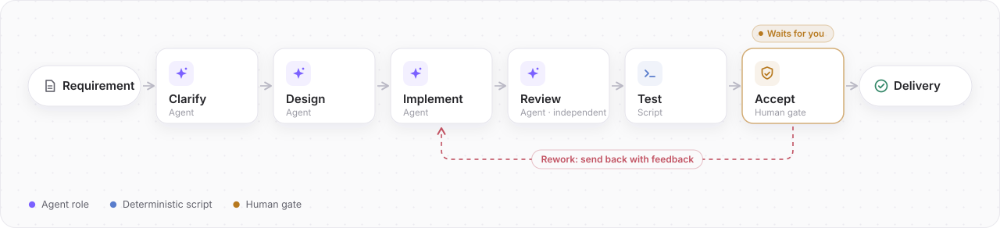

<p align="center">
  <picture>
    <source media="(prefers-color-scheme: dark)" srcset="docs/assets/readme/hero-en-dark.svg">
    
  </picture>
</p>

<p align="center">
  <a href="LICENSE"></a>
  
  
</p>

<p align="center">
  <b>English</b> · <a href="README.zh-CN.md">简体中文</a>
</p>

<p align="center">
  <a href="#two-ways-to-work">Two ways to work</a> ·
  <a href="#webuddy-20-highlights">Webuddy 2.0</a> ·
  <a href="#quick-start">Quick start</a> ·
  <a href="#how-sops-work">SOPs</a> ·
  <a href="#features">Features</a> ·
  <a href="#faq">FAQ</a> ·
  <a href="#documentation">Docs</a>
</p>

**Webuddy (`webuddy-next-loopforge`)** is a self-hosted software delivery workbench built on top of LoopForge. Describe what you need to **Main Bot** in chat: it queries your codebase knowledge graph, opens a Docker sandbox when needed, delegates to project roles, runs AI code reviews, lets you inspect a live app preview, and opens the PR/MR. Once a delivery workflow proves itself, capture it as an **SOP** (a standard pipeline of agents, scripts, and human approval gates) so every future requirement ships with the same rigor.

Webuddy orchestrates 22 coding-agent CLIs — Codex, Claude Code, CodeBuddy, OpenCode, Cursor CLI, Antigravity, Kimi Code, Pi, DeepSeek Harness, ZCode, Gemini CLI, Aider, Cline CLI, Qwen Code, Trae CLI, GitHub Copilot CLI, Sourcegraph Amp, Block Goose, Windsurf CLI, Auggie, Command Code, and Devin CLI — while managing multi-tenant workspaces, source-grounded knowledge graphs, sandboxes, code review feedback loops, and audit trails on your own infrastructure under the MIT license.

## Two ways to work

| | **Chat with Main Bot** | **Run an SOP** |
| --- | --- | --- |
| Best for | Exploration, quick fixes, KB Q&A, live previews, and rapid iteration | Repeatable delivery with fixed stages, review gates, and sign-off |
| How it runs | Main Bot uses direct server KB/preview tools or opens a [conversation workspace](docs/conversation-workspaces.md) (a Docker sandbox with your repos) and calls project roles as subagents | The engine runs Agent, Script, Human-gate, and sub-SOP nodes in order inside dedicated sandboxes |
| You stay in control by | Queuing or steering messages mid-reply, and pausing, resuming, or taking over a running SOP | Approving at human gates, rejecting back to an upstream step, or retrying/rerunning from any node |
| Delivers | A PR/MR, a direct merge (`mode=direct`), or an embedded live preview | Documents, source code, or a PR/MR, plus per-node artifacts, reviews, and logs |

## Webuddy 2.0 highlights

- **Zero-dependency polyglot Knowledge Base (`webuddy_core`)**: Bundled directly inside the platform image (Python stdlib only); extracts architecture graphs, call/dependency chains, impact analysis, and `file:line`-verified KB pages across Go, Python, TS/JS, NestJS, Next.js, C#, PHP, Rust, Ruby, Kotlin, C++, and SQL, plus a Tenant Shared KB Hub.
- **AI Code Review & effectiveness feedback loop**: Batched diff reviews linked to runs and approval gates, with human validity scoring that prevents unreviewed blockers from shipping.
- **1-click live app preview**: Starts project servers in the platform and proxies `/app-preview/<projectId>/` over HTTPS directly inside chat cards.
- **Loose projects & ZIP/TAR.GZ archive upload**: Import code archives without a Git remote; extracted sources are stored under `${WEBUDDY_DATA_DIR}/uploaded-repos` so container recreates never lose data.
- **Multi-tenant isolation & RBAC**: Isolated team workspaces, invite codes, member roles, and tenant-scoped preset SOP policies.
- **3-tier built-in LLM fallback & `pstack` SOPs**: Automatically resolves `WEBUDDY_LLM_*` → `OPENROUTER_API_KEY` → `OPENAI_API_KEY`; defaults generic roles to `codex` and ships 4 built-in `pstack` engineering discipline SOPs.

## Quick start

Install **Git** and clone the repository. The installer checks Docker, Compose, Python 3, and curl, and offers to install missing components (`apt`/`dnf`/`yum` on Linux, Homebrew on macOS, checksum-verified Docker Compose plugin on Linux x86_64/arm64). Non-root users are supported via Docker group membership or `sudo`. Set `WEBUDDY_YES=1` to accept installation prompts non-interactively.

```bash
git clone https://github.com/auntunt/webuddy-next-loopforge.git
cd webuddy-next-loopforge
./start.sh
```

`./start.sh` pulls the pre-built multi-architecture GHCR image pinned in `compose.yaml` (`ghcr.io/auntunt/webuddy-next-loopforge:2.0.0`) without building locally (`bash scripts/install.sh` does the same). It generates `.env` with unique secrets (`WEBUDDY_*`), starts MySQL (`webuddy`) and `platform`, applies schema extensions (`scripts/install-schema-extensions.sh`), and prints reachable public/LAN/local URLs.

> **Private repository & GHCR image access**: Even if `auntunt/webuddy-next-loopforge` remains a Private GitHub repository, setting the `webuddy-next-loopforge` container package visibility to **Public** in GitHub Packages enables zero-login `./start.sh` installs and `ghcr.nju.edu.cn` acceleration for your entire team. Otherwise run `docker login ghcr.io` before `./start.sh`, or build from source with `./start.sh dev`.

### Registry mirrors & source builds

In regions where `ghcr.io` downloads stall, `./start.sh` and `./start.sh pull` probe `ghcr.io` and [ghcr.nju.edu.cn](https://doc.nju.edu.cn/books/e1654/page/ghcr) in parallel, verifying that the mirror returns the exact official manifest SHA-256 digest before pulling and re-tagging locally. You can also pin a registry host or build from source:

```bash
./start.sh                                                                 # auto-probe ghcr.io vs ghcr.nju.edu.cn
MIRROR=ghcr.io ./start.sh                                                  # force direct ghcr.io pull
MIRROR=ghcr.nju.edu.cn ./start.sh pull                                     # force upgrade pull via Nanjing mirror
GOPROXY=https://goproxy.cn,direct NPM_REGISTRY=https://registry.npmmirror.com ./start.sh dev
                                                                           # source build with optional Go/npm mirrors
```

Lifecycle commands:

```bash
./start.sh status     # show container status
./start.sh logs       # follow platform logs
./start.sh pull       # pull updated release image and reapply schema extensions
./start.sh restart    # restart the platform container
./start.sh stop       # stop containers, keep data
./start.sh down       # remove containers, keep mysql-data / platform-data and .data/
./start.sh dev        # build from source (compose.dev.yaml -> webuddy-platform:local)
./start.sh release    # switch a source-built installation back to the GHCR image
```

### Try it without an API key

The first account created in the browser becomes the platform administrator and automatically joins the **Webuddy demo project** (`WB`), which includes a no-key script + approval SOP:

1. Switch to the demo project, open **Templates**, and select **Platform check · script & approval**.
2. Click **Run SOP**. A real script generates `reports/welcome.md`, then pauses at the approval gate.
3. Approve from **Needs review** or the run details page and watch the workflow finish.

<details>
<summary><b>More setup details</b>: env vars, executors, sandboxes, persistence</summary>

<br>

- **Built-in LLM (optional)**: Configure `WEBUDDY_LLM_BASE_URL`, `WEBUDDY_LLM_API_KEY`, `WEBUDDY_LLM_MODEL`, `OPENROUTER_API_KEY`, or `OPENAI_API_KEY` in `.env` or directly in the Web UI.
- **Persistence**: Compose persists MySQL (`mysql-data`, database `webuddy`), platform uploads/sessions (`platform-data` at `/data`), and `${WEBUDDY_DATA_DIR}` (default `./.data`: `home/`, `workspaces/`, `uploaded-repos/`, `conversations/`, `cli/`).
- **Full operations reference**: See [Deployment](docs/deployment.md) for reverse proxies, `/app-preview/` streaming headers, Git SSH trust, connected Runners, backups, and cutting releases.

</details>

## How SOPs work

<p align="center">
  <picture>
    <source media="(prefers-color-scheme: dark)" srcset="docs/assets/readme/sop-flow-en-dark.svg">
    
  </picture>
</p>

| Node | What it does |
| --- | --- |
| **Agent** | A role (prompt, executor, model, rules, Skills, and MCP tools) that plans, implements, reviews, or tests. |
| **Script** | A deterministic shell step: build, test, lint, or report generation. |
| **Human gate** | Pauses the run until a reviewer inspects artifacts and approves or sends work back upstream. |
| **Sub-SOP** | Invokes another SOP as a reusable sub-workflow. |
| **Preview build** | Builds and archives a static site for review. |

## Features

| Area | What you get |
| --- | --- |
| **Chat workbench** | Main Bot with per-session executor, model, and permission controls; `@` mentions for roles, skills, requirements, SOPs, KB pages, and repos; inline artifact and live preview cards. |
| **Conversation workspaces** | On-demand Docker sandboxes with project repos checked out, project roles as subagents, and live SOP pause/resume/takeover controls. |
| **Knowledge Base** | Polyglot structure extraction (`webuddy_core`), module cards, architecture graphs, impact analysis, source-verified incremental synthesis, and Tenant Shared KB Hub. |
| **Code Review loop** | Batched diff review with blocking/advisory findings, human effectiveness feedback, and approval-gate integration. |
| **SOP designer** | Visual canvas with Agent, Script, Human gate, Sub-SOP, and Preview nodes, plus 4 generic delivery SOPs and 4 `pstack` SOPs. |
| **Multi-tenant & RBAC** | Tenant workspaces, invite codes, member RBAC roles, loose project mode, and direct `.zip` / `.tar.gz` archive uploads. |
| **Execution environments** | Built-in Docker sandboxes (reusing the platform image) or 1-line connected local/cloud Runner machines. |

## FAQ

**Do I need an API key to try it?**
No. The demo SOP uses only a script and a human gate. Chat, KB synthesis, and Agent SOP steps require credentials for your chosen executor or `WEBUDDY_LLM_*` / `OPENROUTER_API_KEY`.

**Can I use Webuddy without a Git repository?**
Yes. Create a loose project or upload a `.zip` / `.tar.gz` code archive; Webuddy persists it in `${WEBUDDY_DATA_DIR}/uploaded-repos`, scans its architecture/KB, and supports live preview.

**Is it safe to expose on the public internet?**
New installs listen on `0.0.0.0:8090` for trusted teams. Register the first admin account immediately, place an HTTPS reverse proxy in front with `AGENTFLOW_SECURE_COOKIES=true`, and set `AGENTFLOW_ALLOW_SIGNUP=false` if public signups should be disabled. See [accounts and access](docs/deployment.md#accounts).

## Documentation

| I want to… | Start here |
| --- | --- |
| Deploy, upgrade, configure env vars, back up, and release | [Deployment](docs/deployment.md) |
| Understand chat workspaces, AI schedules, and token pricing | [Conversation workspaces](docs/conversation-workspaces.md) · [AI scheduled tasks](docs/ai-scheduled-task-capabilities.md) · [Token pricing](docs/token-pricing.md) |
| Extend the platform or use HTTP / MCP APIs | [Architecture](docs/architecture.md) · [API reference](docs/api/README.md) · [Shared schedules API](docs/api/shared-schedules.md) |
| Contribute to the UI | [Frontend design conventions](design.md) |
| Maintain legacy Local workflows | [Webuddy/LoopForge Local](docs/local/usage.md) · [Editions](docs/local/editions.md) |

## License

[MIT](LICENSE). Third-party components keep their own licenses and notices; see [THIRD_PARTY_NOTICES.md](THIRD_PARTY_NOTICES.md).
