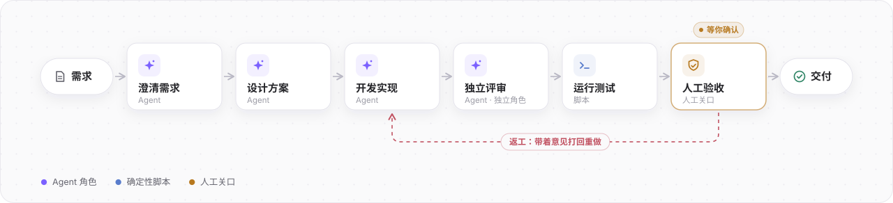

<p align="center">
  <picture>
    <source media="(prefers-color-scheme: dark)" srcset="docs/assets/readme/hero-zh-dark.svg">
    
  </picture>
</p>

<p align="center">
  <a href="LICENSE"></a>
  
  
</p>

<p align="center">
  <a href="README.md">English</a> · <b>简体中文</b>
</p>

<p align="center">
  <a href="#两种工作方式">两种工作方式</a> ·
  <a href="#webuddy-20-核心增强">Webuddy 2.0 增强</a> ·
  <a href="#快速开始">快速开始</a> ·
  <a href="#sop-如何运行">SOP</a> ·
  <a href="#功能一览">功能</a> ·
  <a href="#常见问题">FAQ</a> ·
  <a href="#文档">文档</a>
</p>

**Webuddy（`webuddy-next-loopforge`）** 是基于 LoopForge 演进的可自主部署软件交付工作台，让你和编程 Agent 一起交付软件。在对话里把需求告诉 **Main Bot**：它会按需打开 Docker 沙箱、检出或导入项目代码、结合项目源码知识库规划和派发任务、执行 AI Code Review 与人工验收，最后提交 PR/MR 或直推预览。某种做法被验证有效后，把它存成 **SOP**（由 Agent、脚本和人工关口组成的标准交付流程），下一个需求就按同样的方式交付。

干活的是 22 种主流编程 Agent CLI（Codex、Claude Code、CodeBuddy、OpenCode、Cursor CLI、Antigravity、Kimi Code、Pi、DeepSeek Harness、ZCode、Gemini CLI、Aider、Cline CLI、Qwen Code、Trae CLI、GitHub Copilot CLI、Sourcegraph Amp、Block Goose、Windsurf CLI、Auggie、Command Code、Devin CLI）；Webuddy 负责它们外面的源码知识图谱、角色隔离、多租户工作空间、沙箱、Code Review 闭环、实时预览和运行留痕，MIT 开源。

## 两种工作方式

| | **与 Main Bot 对话** | **运行 SOP** |
| --- | --- | --- |
| 适合 | 探索、快速修复、知识库问答、实时预览与快速迭代 | 阶段固定、需要独立评审与签字确认的可重复交付 |
| 如何运行 | Main Bot 按需打开[对话工作区](docs/conversation-workspaces.md)（带项目仓库的 Docker 沙箱），调用项目角色与直连知识库工具 | 引擎按顺序执行 Agent、脚本、人工关口和子 SOP 节点，每次运行有独立沙箱 |
| 你如何把控 | 回复中途排队或「引导」消息；在对话里暂停、恢复或接管正在运行的 SOP | 在人工关口审批；打回到指定环节返工；从任意节点重试或重跑 |
| 交付物 | PR/MR、共享分支直推（`mode=direct`），或实时应用预览 | 文档、代码或 PR，以及每个节点的产物、评审与日志 |

## Webuddy 2.0 核心增强

- **源码知识库与多语言图谱（`webuddy_core`）**：零外部 Python 第三方依赖，内置在平台镜像中；支持 Go / Python / TS / JS / NestJS / Next.js / C# / PHP / Rust / Ruby / Kotlin / C++ / SQL 架构抽取、依赖链路分析、`file:line` 源码溯源校验与租户共享知识中心。
- **AI Code Review 与有效性闭环**：支持按批提交 diff 审查，区分阻断项/建议项，人工反馈结果反哺后续交付与审核关口。
- **一键实时应用预览**：支持在平台内直接启动项目并打穿 `/app-preview/<projectId>/` HTTPS 代理，前端卡片内嵌可交互预览。
- **松散项目与压缩包导入**：支持无 Git 仓库直接上传 `.zip` / `.tar.gz` / `.tgz` 代码包（持久化落在 `${WEBUDDY_DATA_DIR}/uploaded-repos`），自动扫描构建知识库与环境。
- **多租户隔离与团队 RBAC**：支持团队空间隔离、邀请码加入、成员权限管控与预置 SOP 策略。
- **内置模型三层回退 & 4 条 `pstack` 内置 SOP**：支持 `WEBUDDY_LLM_*` → `OPENROUTER_API_KEY` → `OPENAI_API_KEY` 自动发现回退；默认执行器切换为 `codex`，预置 `pstack` 现状核对、小步交付、实证审查、减法重构 4 条工程 SOP。

## 快速开始

先准备 **Git** 并克隆仓库。安装脚本会检查 Docker、Compose、Python 3 和 curl，并在获得确认后补装缺少的组件：Linux 的 Python/curl 支持 apt、dnf、yum，Compose 插件支持 x86_64/arm64 并校验官方发行文件的 SHA-256；macOS 需要可运行的 Python 3 和 Docker Desktop，可通过 Homebrew 补装缺少的组件。支持普通用户运行，需要时通过 Docker 组或 sudo 操作 Docker。设置 `WEBUDDY_YES=1` 可跳过确认提示。

```bash
git clone https://github.com/auntunt/webuddy-next-loopforge.git
cd webuddy-next-loopforge
./start.sh
```

`./start.sh` 直接拉取 `compose.yaml` 中 pin 的 GHCR 发布镜像（`ghcr.io/auntunt/webuddy-next-loopforge:2.0.0`），不在本地编译（`bash scripts/install.sh` 效果相同）。安装流程会自动：

1. 生成 `.env`（包含随机数据库密码、会话密钥与 `${WEBUDDY_DATA_DIR}` 持久化目录）；
2. 拉取发布镜像并启动 `mysql`（库名/用户 `webuddy`）与 `platform`（默认监听 `0.0.0.0:8090`）；
3. 等 `/api/health` 就绪后，自动运行 `scripts/install-schema-extensions.sh` 补齐观测列、`webuddy_code_reviews` 表、公共目录与 `031/033/038` 迁移；
4. 自动探测云厂商公网 IP（腾讯云 / 阿里云 / AWS / GCP / Azure）及局域网/本机访问地址。

> **关于私有仓库与 GHCR 镜像可见性**：如果 `auntunt/webuddy-next-loopforge` 代码仓库保持 Private，只需在 GitHub Packages 将 `webuddy-next-loopforge` 容器镜像设为 **Public**，团队成员即可在任意机器免登录直接 `./start.sh` 并享南京大学镜像加速；如果镜像也保持 Private，安装前先执行 `docker login ghcr.io` 即可，或者使用 `./start.sh dev` 从本地源码构建。

### 国内镜像加速与源码构建

国内拉取 `ghcr.io` 经常中断。`./start.sh` 和 `./start.sh pull` 会并行测速 `ghcr.io` 与南京大学镜像 [ghcr.nju.edu.cn](https://doc.nju.edu.cn/books/e1654/page/ghcr)：只有当官方 manifest SHA-256 摘要与南京镜像一致时，才按摘要拉取并自动回标为 `compose.yaml` 中的官方镜像名。也可以手动固定源或从源码构建：

```bash
./start.sh                                                                 # 自动测速拉取发布镜像
MIRROR=ghcr.io ./start.sh                                                  # 强制直连官方 ghcr.io
MIRROR=ghcr.nju.edu.cn ./start.sh pull                                     # 强制经南京大学镜像升级更新
GOPROXY=https://goproxy.cn,direct NPM_REGISTRY=https://registry.npmmirror.com ./start.sh dev
                                                                           # 使用国内 Go/npm 代理从源码构建
```

常用运维命令：

```bash
./start.sh status     # 查看容器运行状态
./start.sh logs       # 实时跟踪 platform 日志
./start.sh pull       # 升级到当前 checkout 对应的发布镜像并执行增量 Schema 扩展
./start.sh restart    # 重启 platform 服务
./start.sh stop       # 停止容器（保留数据）
./start.sh down       # 删除容器（保留 mysql-data / platform-data 与 .data/）
./start.sh dev        # 切换到源码构建模式（compose.dev.yaml -> webuddy-platform:local）
./start.sh release    # 从源码构建切回 GHCR 发布镜像模式
```

### 免 API Key 体验

新注册的第一个账号自动成为平台管理员，并自动加入 **Webuddy 体验项目**（`WB`），其中内置一条仅包含脚本和人工审批的 SOP：

1. 切换到体验项目，打开 **流程模板**，进入 **平台验收 · 脚本与审批**。
2. 点击 **运行流程**。真实脚本会生成验收报告，然后在审批节点等你确认。
3. 在 **待我确认** 或运行详情页审批通过，观察流程继续执行并产出最终产物。

### 真实任务需要准备什么

| 我想要… | 需要准备 |
| --- | --- |
| 跑通脚本 + 人工审批体验 | 什么都不需要 |
| 与 Main Bot 对话、分析本地/压缩包源码知识库、生成文档或新项目 | 所选执行器的凭据（或配置 `WEBUDDY_LLM_*` / `OPENROUTER_API_KEY`） |
| 修改已有仓库并提交 PR/MR | 执行器凭据 + GitHub 授权或 Git SSH 密钥（在个人设置中配置） |

<details>
<summary><b>更多配置说明</b>：环境变量、执行器、沙箱、数据持久化</summary>

<br>

- **内置模型环境变量（可选）**：可在 `.env` 中配置 `WEBUDDY_LLM_BASE_URL`、`WEBUDDY_LLM_API_KEY`、`WEBUDDY_LLM_MODEL`、`OPENROUTER_API_KEY` 或 `OPENAI_API_KEY`；也可在界面 **平台管理 / 个人设置** 中直接配置。
- **默认执行器与 22 种 CLI**：内置通用 SOP 默认使用 `codex`（可在角色或模板中切换为 `claude`、`codebuddy`、`gemini-cli`、`opencode`、`cursor`、`agy`、`kimi`、`pi`、`dsh`、`zcode`、`aider`、`cline`、`qwen-code`、`trae`、`copilot`、`amp`、`goose`、`windsurf`、`auggie`、`command-code`、`devin`）。
- **持久化目录**：Compose 安装会自动把数据持久保存在：
  - Docker 卷：`mysql-data`（MySQL 8.4 库 `webuddy`）、`platform-data`（`/data/assistant`、`/data/clarify`）；
  - 宿主机目录 `${WEBUDDY_DATA_DIR}`（默认 `./.data`）：`home/`（含 `.webuddy-tenants.json`、`.webuddy-platform-policy.json`、`.webuddy-user-rbac.json`、`.webuddy-shared-kb.json`、`.webuddy-builtin-llm.json`）、`workspaces/`、`uploaded-repos/`、`conversations/`、`cli/`。
- **更多细节**：独立 Worker/Runner 接入、Git SSH 信任、HTTPS 反向代理与 `/app-preview/` 配置、首次发版流程，详见 [部署指南](docs/deployment.md)。

</details>

## SOP 如何运行

<p align="center">
  <picture>
    <source media="(prefers-color-scheme: dark)" srcset="docs/assets/readme/sop-flow-zh-dark.svg">
    
  </picture>
</p>

| 节点 | 作用 |
| --- | --- |
| **Agent** | 一个角色（提示词、执行器、模型、规则、Skills、MCP 工具），负责设计、实现、评审或测试。 |
| **脚本** | 确定性的 Shell 步骤：构建、测试、Lint、生成报告。不需要 AI 的地方就不用 AI。 |
| **人工关口** | 暂停运行，等人检查产物后放行，或打回到指定环节。 |
| **子 SOP** | 把另一条 SOP 作为子流程复用。 |
| **预览构建** | 构建静态站点并归档，供评审查看。 |

## 功能一览

| 方向 | 能力 |
| --- | --- |
| **对话工作台** | Main Bot 支持按会话选择执行器、模型和确认模式；`@` 引用角色、技能、需求、SOP、知识库与仓库；生成文件与实时应用预览直接在对话内展示。 |
| **对话工作区** | 按需创建带项目仓库的 Docker 沙箱，把项目角色作为原生子 Agent 调用，并可直接暂停、恢复或接管正在运行的 SOP。 |
| **源码知识库** | `webuddy_core` 多语言结构抽取、模块知识卡、架构图谱、依赖链与影响面分析、增量更新 `file:line` 源码溯源、租户共享知识中心。 |
| **Code Review 闭环** | AI 代码评审列表、行级阻断项/建议项、人工有效性评分反馈、阻断未通过禁止放行验收关口。 |
| **流程设计器** | 可视化画布编排 Agent、脚本、人工关口、子 SOP 与预览构建节点；内置 4 条通用交付 SOP 与 4 条 `pstack` 工程纪律 SOP。 |
| **多租户与治理** | 团队空间切换与邀请码、成员 RBAC 权限管理、松散项目模式与代码压缩包直接导入。 |
| **执行环境** | 平台 Docker 沙箱，或一行命令接入本地/云服务器 Runner 执行机（保留本机 CLI 登录态）。 |

## 常见问题

**体验需要 API Key 吗？**
不需要。体验 SOP 只包含脚本和人工审批。对话、知识库增量合成和 Agent 步骤需要配置执行器凭据或 `WEBUDDY_LLM_*` / `OPENROUTER_API_KEY`。

**没有 Git 仓库也能用吗？**
可以。你可以直接创建松散项目，或者上传 `.zip` / `.tar.gz` 代码压缩包，Webuddy 会自动持久化落盘并完成知识库扫描与实时预览。

**为什么首次安装拉取发布镜像很快？**
`compose.yaml` 指向预编译多架构镜像（`linux/amd64` + `linux/arm64`），`./start.sh` 无需在你的服务器编译前端或 Go，直接拉取即可运行；默认沙箱也直接复用同一个运行时镜像。

**可以直接暴露到公网吗？**
新安装默认监听 `0.0.0.0:8090`。开放公网前请先完成首个管理员账号注册、配置 HTTPS 反向代理并设置 `AGENTFLOW_SECURE_COOKIES=true`，按需设置 `AGENTFLOW_ALLOW_SIGNUP=false` 关闭自助注册。详见[部署指南](docs/deployment.md#accounts)。

## 文档

| 我想了解 | 从这里开始 |
| --- | --- |
| 部署、升级、环境变量、备份与发版 | [部署指南](docs/deployment.md) |
| 对话工作区、AI 定时任务与 Token 成本口径 | [对话工作区](docs/conversation-workspaces.md) · [AI 定时任务](docs/ai-scheduled-task-capabilities.md) · [Token 成本统计](docs/token-pricing.md) |
| 扩展平台或接入 HTTP / MCP API | [架构](docs/architecture.md) · [API 参考](docs/api/README.md) · [共享定时任务 API](docs/api/shared-schedules.md) |
| 参与前端开发 | [前端设计约定](design.md) |
| 本地独立工作流工具（Legacy） | [Local 使用指南](docs/local/usage.zh-CN.md) · [版本差异](docs/local/editions.md) |

## 许可证

[MIT](LICENSE)。第三方组件保留各自许可证与版权声明，见 [THIRD_PARTY_NOTICES.md](THIRD_PARTY_NOTICES.md)。
