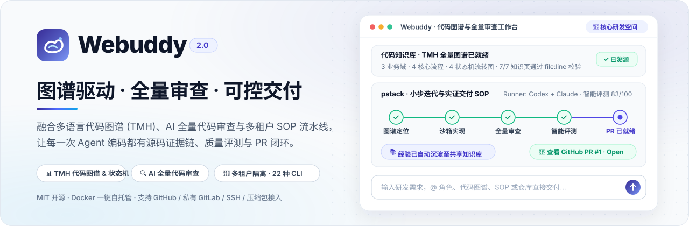

  <picture>
    <source media="(prefers-color-scheme: dark)" srcset="docs/assets/readme/hero-zh-dark.svg">
    
  </picture>

  
  
  
  
  

  <a href="README.md">简体中文（主页）</a> · <a href="README.en.md">English</a>

> 中文主文档已设仓库默认首页，请直接阅读 [README.md](README.md)（英文版见 [README.en.md](README.en.md)）。
