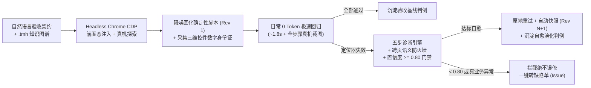

# AI 自动化测试、真机固化与五步自愈指南

> Webuddy AutoTest 融合了两大一线工程实践范式：
> - **确定性固化 + 五步诊断自愈飞轮**（解决脚本难写、周迭代 UI 微调易碎、纯 AI 现跑贵且慢）；
> - **研发上下文资产与判例库沉淀**（解决单兵指挥全局、人不盯跑批、异常才精准找人拍板）。

---

## 1. 核心架构：从“纯 AI 现跑”到“0-Token 固化 + 失败自愈”

---

## 2. 四大关键工程护栏

### 2.1 前置状态直接注入（Precondition Injection）
针对需要登录态或特定角色的业务页面，无需编写脆弱的账号密码输入与验证码流程。可在用例中配置 `preconditionUrl`（例如演示环境的 `/auth/dev?id=1&to=admin`），执行前由 Headless Chrome 直接注入目标会话态并进入业务工作台，大幅提升回归速度与稳定性。

### 2.2 控件三维数字身份证（Element Portrait）
每个可交互或断言定位步骤在真机跑通固化时，引擎会自动从真实 DOM 采集三维画像：
1. **语义角色与文案**：`role`、`tag`、`text`、`ariaLabel`、`placeholder`、`href`；
2. **页面业务上下文**：邻近标题、卡片/区块上下文（`parentContext`）；
3. **DOM 结构层级**：祖先节点拓扑路径（`domPath`）与所属路由基线（`pagePathPattern`）。

### 2.3 五步诊断法与跨页语义防火墙（先硬后软、宁可不修也不误修）
一旦回归步骤定位失败，引擎按严格顺序执行五步排查：
1. **① 目标服务与网络探活**：探测目标站点 HTTP 可达性，若返回 `5xx` 或连接拒绝，直接判定 `ENV_UNAVAILABLE`，绝不误修脚本；
2. **② 浏览器驱动会话存活检测**：校验 CDP 会话与页面 DOM 存活状态；
3. **③ 视觉与语义弹窗引擎**：自动扫描并消解遮挡模态框（权限/合规类放行，通知/引导类关闭）后重试原定位器；
4. **④ 跨页语义防火墙**：比对当前 `location.pathname` 与控件画像绑定的 `pagePathPattern`。若因会话过期被重定向回 `/login`，**直接拦截（置信度归零）**，杜绝在登录页误点近似按钮导致“假成功漏测”；
5. **⑤ 三维控件画像比对 + `Confidence ≥ 0.80` 门禁**：对当前页全部可见控件进行三维加权评分（必要时启用内置大模型语义复核），仅当综合置信度 `≥ 0.80` 且原地重试通过时，才更新定位器并生成新快照。

### 2.4 双层快照护栏与上下文判例库（Precedents）
- **版本快照与一键回滚**：每次自愈均生成新的 `Rev N` 快照，展示失效旧定位器 → 新定位器的 Diff 卡片；人工点击 **「一键回滚」** 即可秒级恢复上一版本，并将被否决的选择器自动写入 **「🛑 回滚防误修护栏」**，后续自愈不再选用。
- **业务断言失败绝不掩盖**：若控件已找到但接口返回错误或页面数据不符契约，系统判定为 `BUSINESS_ASSERTION_FAILED`，提供 **「🚨 一键转缺陷单 (Issue)」**，将现场真机截图与五步诊断明细打包进入 Webuddy 需求池。

---

## 3. 日常三种使用方式

1. **可视化工作台**：点击左侧主导航 **「自动化测试」**（`#/autotest`），支持一键 AI 生成并真机固化、0-Token 极速复放、点击 **「🧪 模拟 UI 改版定位失效」** 演练五步自愈与快照回滚。
2. **聊天框 0-Token 瞬时指令**：
   - `/test` — 毫秒级列出当前项目所有固化用例、版本、通过率与 0-Token 回归次数；
   - `/test run`（或 `/test run all`）— 真机跑完当前项目全部固化回归用例；
   - `/test run <用例关键词或ID>` — 单独复放指定用例。
3. **Main Bot 自然语言委托**：直接对 Main Bot 说“帮我给当前项目的算薪页面生成一条自动化回归用例并跑通”，Main Bot 会自动调用内置 `webuddy_autotest_manage` 工具完成真机探索与固化。
